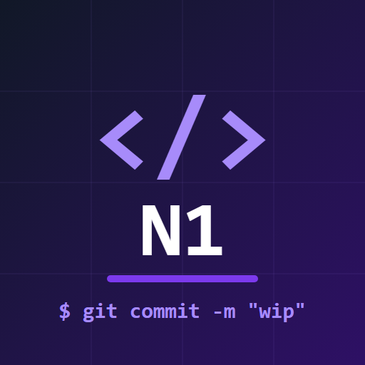

> 👔 **Disclaimer:** the respectable, résumé-friendly version of me lives at [**@nayanjaiswalgit**](https://github.com/nayanjaiswalgit). They wear a collar and have *professional experience* listed.
> This account? Pajamas, 3 a.m., and `git commit -m "it works somehow"`.

## 🧪 What's cooking in here

| Repo | The pitch |
|---|---|
| 🤖 [**job-apply**](https://github.com/nayanjaiswal1/job-apply) | LangGraph multi-agent system that hunts jobs, tailors résumés, writes cover letters and preps interviews. Yes, I automated my own job hunt |
| 🧠 [**mcp-context-cache**](https://github.com/nayanjaiswal1/mcp-context-cache) | MCP server so your AI stops re-reading the same files |
| 🦊 [**gitlab-mcp**](https://github.com/nayanjaiswal1/gitlab-mcp) | GitLab, but your agent can drive |
| 🗒️ [**notion-table**](https://github.com/nayanjaiswal1/notion-table) | Zero-dependency Notion-style editable table Web Component |
| 🧰 [**project-templates**](https://github.com/nayanjaiswal1/project-templates) | Production-ready React / FastAPI / Django starters |
| 🚢 [**better-way-to-ship**](https://github.com/nayanjaiswal1/better-way-to-ship) | Field guide to CI/CD, security and not breaking prod |
| 🎯 [**45-day-interview-roadmap**](https://github.com/nayanjaiswal1/45-day-interview-roadmap) | Full-stack interview prep, one day at a time |
| ⚒️ [**forge-kit**](https://github.com/nayanjaiswal1/forge-kit) · [**scalecraft**](https://github.com/nayanjaiswal1/scalecraft) | Tooling experiments |

## 🔨 Currently obsessed with

**MindForge**: a multi-tenant learning platform (think LeetCode × KodeKloud × Udemy × Notion). Go + Next.js + Postgres, running on k3s at [sadhaklab.in](https://sadhaklab.in).

## 🛠 Weapons of choice

## 📊 Stats

